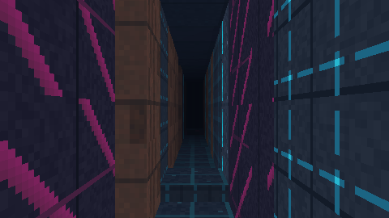
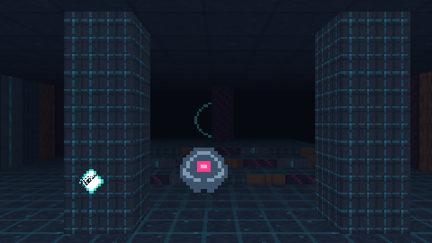

# CPU 地牢 · CPU Dungeon v2

一款**全程 CPU 软件光栅化**的 Android 第一人称 3D 地牢游戏：没有 OpenGL/Vulkan 渲染管线、没有游戏引擎、没有第三方依赖、没有任何图片素材。Release APK 约 **60 KB**，远低于 1 MB。




> 以上均为引擎无头渲染输出（未叠加 HUD），由 `tools/HeadlessGame3D.java` / `tools/Scene3D.java` 直接调用游戏内同一套渲染器生成。

## v2 是什么

v1 是光线投射伪 3D；v2 换成了**真正的软件三角形光栅化**：

- 自由抬头/低头（±75°），真正的透视投影
- 程序化迷宫带**高差与台阶**，可以跳跃、下蹲、爬楼
- 墙体、地板、天花板都是真实几何，逐像素 z-buffer
- 敌人/核心/传送门仍是广告牌（省性能），但按相机矩阵投影并参与深度测试

## 玩法

- 潜入霓虹地牢，收集全部**能量核心**，激活传送门进入下一层。
- 猎杀无人机巡逻、索敌并追击；贴近会持续掉血。
- 无限层数，层数越高迷宫越大、台阶越多、敌人越快。
- **跳跃**可上 0.8 m 的平台；**下蹲**降低视点与移速，用来钻窄通道/稳定瞄准。

## 操作

| 平台 | 移动 | 转向/俯仰 | 开火 | 跳跃 | 下蹲 | 重开 |
| --- | --- | --- | --- | --- | --- | --- |
| 触屏 | 左侧摇杆 | 右半屏滑动（横向转向、纵向抬头） | 按住 FIRE / 轻点右半屏 | JUMP | 按住 CROUCH | 死亡后轻点屏幕 |
| 键盘 | WASD | Q/E 转向，方向键上下俯仰 | F / 空格 | 空格 | Shift / Ctrl | 空格 |

**设置**：左上角 `SET` 打开面板，可调**转向/俯仰灵敏度**（0.4x–2.8x），并可进入 **CUSTOM TOUCH LAYOUT** 直接拖动 FIRE / JUMP / CROUCH 三个按钮到顺手的位置；重置与灵敏度会立即保存。

**彩蛋**：右上角小区域连点 10 次解锁 `OVERCLOCK`（无敌、三倍伤害、高射速、**透视**、**1.9 倍移速**）；再连点 10 次关闭。

## 技术要点

| 模块 | 实现 |
| --- | --- |
| 几何 | 网格 + 0.25 m 量化高度场 → 墙面/台阶/地板四边形 |
| 管线 | 相机变换 → 近平面裁剪（Sutherland–Hodgman）→ 透视除法 → 边函数光栅化 |
| 纹理 | 64×64 程序化纹理 + 32/16/8 mip 链，1/z 透视校正采样 |
| 深度 | `float[]` z-buffer，逐像素 1/z 测试 |
| 光照 | 逐面方向光烘焙 + 距离雾（逐三角形） |
| 物理 | 重力、跳跃、下蹲、0.3 m 自动上台阶、平台边缘跌落 |
| AI | 玩家 BFS 流场 + 视线检测 + 群体分离；无人机悬浮无视高差 |
| HUD | 软件 Canvas（血条、高度着色小地图、准星、程序化枪械、跳跃/下蹲键、设置面板、可拖动键位） |
| 性能 | 内部 240–520 px 宽自适应；HUD 实时显示 CPU 分辨率与 FPS |
| 依赖 | 无 AndroidX、无 Kotlin、无网络、无权限、无图片素材 |

实测（开发机 x86，480×270，含 AI 与精灵）：`update + render` 约 **3.1 ms/帧**。

## 构建

```bash
gradle assembleRelease
# 产物：app/build/outputs/apk/release/app-release.apk
```

云端：推送到 `main` 自动编译并校验 APK < 1 MB；打 `v*` tag 自动创建 GitHub Release 并附带 APK，同时用 `apksigner` 打印签名证书。

## 本地验证（无需 Android 设备）

```bash
mkdir -p /tmp/cd3d
javac -encoding UTF-8 -d /tmp/cd3d $(find app/src/main/java/com/lyq/cpudungeon/engine app/src/main/java/com/lyq/cpudungeon/engine3d -name '*.java') tools/Engine3DTest.java tools/HeadlessGame3D.java tools/Scene3D.java
java -cp /tmp/cd3d Engine3DTest      # 台阶可达性 / 跳跃 / 下蹲 / 长时间模拟
java -cp /tmp/cd3d HeadlessGame3D    # 输出 tools/out3d/*.png 视觉检查 + 性能数字
java -cp /tmp/cd3d Scene3D           # 定向测试房间：平台、台阶、柱子、精灵遮挡
```

## 目录

```
app/src/main/java/com/lyq/cpudungeon/
├── MainActivity.java          # 全屏沉浸 / 生命周期
├── GameView.java              # 渲染线程、触控、自适应分辨率、彩蛋入口
├── CrashLog.java              # 设备端崩溃落盘
├── engine/                    # 与平台无关的基础类型
│   ├── Textures.java          # 程序化纹理与精灵
│   ├── Sprite / Enemy / Pickup / Particle / Input
└── engine3d/                  # 真 3D 软件渲染器
    ├── Renderer3D.java        # 裁剪 / 光栅化 / z-buffer / 广告牌
    ├── MeshBuilder3D.java     # 高度场 → 四边形
    ├── MapGen3.java           # 迷宫 + 高度 + 台阶平滑
    ├── Game3D.java            # 玩法 / 物理 / AI
    ├── Camera3D.java
    └── ...
tools/                         # 无头测试与渲染工具
docs/                          # 架构说明 / TODO
```

## 签名

包名 `com.lyq.cpudungeon`，正式签名证书 SHA-256：

```
4F:E1:7C:02:2E:1B:56:BE:DF:C9:05:70:B3:BD:4E:BF:91:8B:1C:9B:F3:3B:37:9A:A2:D0:86:2B:C2:14:4A:7A
```

CI 通过 `KEYSTORE_BASE64 / STORE_PASSWORD / KEY_ALIAS / KEY_PASSWORD` 注入签名；缺失时回退 debug 签名。

## 已知限制

见 [docs/TODO.md](docs/TODO.md)：暂无音效、无存档、敌人只有一种、俯仰 ±75° 之外会看到几何边缘。
