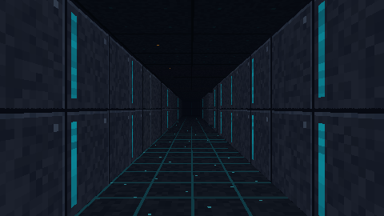
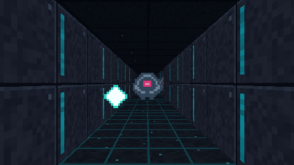

# CPU 地牢 · CPU Dungeon

一款**全程 CPU 软件光栅化**的 Android 第一人称地牢游戏：没有 OpenGL/Vulkan 渲染管线、没有游戏引擎、没有第三方依赖、没有任何图片素材，APK 控制在 **1 MB 以内**。




> 上图是引擎的无头渲染输出（未叠加 HUD），由 `tools/HeadlessRender.java` 直接调用同一套渲染代码生成。

## 玩法

- 潜入程序化生成的霓虹地牢，收集全部**能量核心**，激活紫色传送门进入下一层。
- 「猎杀无人机」会巡逻、索敌并追击；被贴近会持续掉血。
- 无限层数，层数越高迷宫越大、敌人越多越快；死亡后点击屏幕重启。

## 操作

| 平台 | 移动 | 转向 | 开火 | 重开 |
| --- | --- | --- | --- | --- |
| 触屏 | 左侧虚拟摇杆 | 右半屏滑动 | 按住右下 FIRE / 轻点右半屏 | 死亡后轻点屏幕 |
| 键盘（模拟器） | WASD | Q / E 或方向键 | 空格 | 空格 |

## 技术要点

| 模块 | 实现 |
| --- | --- |
| 墙体 | 逐列 DDA 光线投射 + 64×64 程序化纹理 + 距离雾 |
| 地面/天花板 | 逐行反向投影（floor casting），逐行光照 |
| 精灵 | 广告牌投影 + 逐列 z-buffer 遮挡 + alpha 混合 |
| 素材 | 全部由哈希噪声 / 像素字符画在启动时生成，APK 无贴图 |
| AI | 玩家 BFS 流场寻路 + 视线检测 + 群体分离 |
| HUD | 软件 Canvas 绘制（血条、小地图、准星、程序化枪械） |
| 性能 | 引擎只写 `int[]` 帧缓冲，内部 240–560 px 宽自适应调节，目标 60 FPS |
| 依赖 | 无 AndroidX、无 Kotlin、无网络、无权限 |

实测（开发机 x86，480×270）：`update + render` 约 **1.3 ms/帧**，即每帧 CPU 渲染预算的 ~8%。

## 构建

```bash
# 需要 JDK 17 + Android SDK 34 + Gradle 8.2.1
gradle assembleRelease
# 产物：app/build/outputs/apk/release/app-release.apk
```

云端：推送到 `main` 自动编译并校验 APK < 1 MB；打 `v*` tag 自动创建 GitHub Release 并附带 APK。

## 本地验证（无需 Android 设备）

```bash
mkdir -p /tmp/cdbuild
javac -encoding UTF-8 -d /tmp/cdbuild $(find app/src/main/java/com/lyq/cpudungeon/engine -name '*.java') tools/EngineTest.java tools/HeadlessRender.java
java -cp /tmp/cdbuild EngineTest        # 地图连通性 / 刷新点 / 战斗 / 模拟稳定性
java -cp /tmp/cdbuild HeadlessRender    # 输出 tools/out/*.png 供肉眼检查
```

## 目录

```
app/src/main/java/com/lyq/cpudungeon/
├── MainActivity.java        # 全屏沉浸 / 生命周期
├── GameView.java            # SurfaceView 渲染线程、输入、自适应分辨率
├── engine/                  # 纯 Java，无 Android 依赖
│   ├── Raycaster.java       # 逐像素软件渲染器
│   ├── Textures.java        # 程序化纹理与精灵
│   ├── MapGen.java          # 迷宫生成 / 编织 / 连通修复
│   ├── Game.java            # 玩法与 AI
│   └── ...
└── ui/Hud.java              # 软件 Canvas HUD
tools/                       # 无头测试与渲染工具
docs/                        # 架构说明 / TODO
```

## 签名

包名 `com.lyq.cpudungeon`，正式签名证书 SHA-256：

```
4F:E1:7C:02:2E:1B:56:BE:DF:C9:05:70:B3:BD:4E:BF:91:8B:1C:9B:F3:3B:37:9A:A2:D0:86:2B:C2:14:4A:7A
```

CI 通过 `KEYSTORE_BASE64 / STORE_PASSWORD / KEY_ALIAS / KEY_PASSWORD` 四个 Secrets 注入签名，缺失时回退 debug 签名（仍可直接安装）。

## 已知限制

见 [docs/TODO.md](docs/TODO.md)：暂无音效、无存档、敌人只有近战型、极低端设备可能需要更低内部分辨率。
